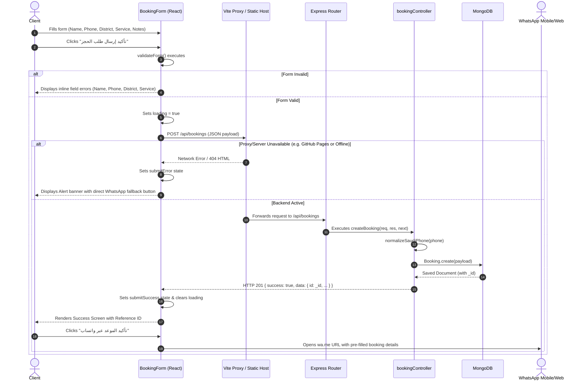

# Nawaz AC & Home Maintenance — Complete Project Structure & Architecture Analysis

> **Document Type:** System Architecture & Migration Feasibility Report  
> **Repository:** `Muhammad-Mohsin66/Nawaz-AC-Home-Maintenance`  
> **Target Migration:** Android WebView APK Conversion + Full Backend Removal (Direct WhatsApp Booking)  
> **Audit Status:** Read-Only Complete Audit (No codebase changes made)  
> **Date:** October 2026  

---

## 1. Project Overview

**Nawaz AC & Home Maintenance (نواز لصيانة المكيفات والخدمات المنزلية)** is a bilingual (Arabic-first, RTL) web application designed for a residential and commercial maintenance contractor based in Riyadh, Saudi Arabia.

The application currently provides:
- Showcase of 4 primary service categories: Air Conditioning (التكييف), Electrical (الكهرباء), Plumbing (السباكة), and General Home Maintenance (الصيانة المنزلية العامة).
- Interactive booking form collecting client name, Saudi mobile number, Riyadh district, selected service, and notes.
- Dual submission mechanism: API submission to an Express/MongoDB backend combined with direct deep-linking to WhatsApp.
- Verification and trust section displaying Saudi Commercial Registration (CR), 700 Unified Number, ZATCA VAT Certificate, and Saudi Post National Address with preview modals.
- Media showcases including the contractor's official logo, high-resolution technician imagery, and promotional video.

The application was originally architected as a **MERN Stack** (MongoDB, Express, React, Node.js) application. However, **the frontend is 100% self-sufficient for content presentation**; all service catalogues, business credentials, and district options are statically bundled into the client bundle. The backend is exclusively utilized for an optional booking record collection in MongoDB.

---

## 2. Complete Project Folder Structure

The following tree represents the entire workspace, excluding `.git`, `node_modules`, and transient artifacts:

```text
D:/mohsin/
├── .github/
│   └── workflows/
│       └── deploy.yml                                # GitHub Actions workflow (builds client & deploys to GitHub Pages)
├── assets/                                           # Root media assets directory (mirrors client public assets)
│   ├── logo.jpeg                                     # Official business circular badge / logo
│   ├── pic.jpg                                       # Field technician photo
│   └── video.mp4                                     # Promotional MP4 video
├── client/                                           # Frontend Application (React 19 + Vite + Tailwind CSS v4)
│   ├── public/                                       # Static files served directly by Vite
│   │   ├── documents/                                # Official legal PDF and image credentials
│   │   │   ├── commercial-registration.pdf           # Ministry of Commerce CR (سجل تجاري 1010469561)
│   │   │   ├── national-address.jpeg                 # Saudi Post SPL National Address certificate
│   │   │   └── vat-certificate.pdf                   # ZATCA VAT Certificate (الرقم الضريبي 310156889300003)
│   │   ├── images/                                   # Optimized images for UI consumption
│   │   │   ├── logo.jpeg                             # High-res business logo (used in Navbar, Hero, Lightbox, Footer)
│   │   │   ├── national-address.jpeg                 # National address image preview
│   │   │   └── technician.jpg                        # Supervisor Eng. Nawaz Ameen on-site photo
│   │   ├── videos/                                   # HTML5 video assets
│   │   │   └── promo.mp4                             # High-definition promotional reel for AC maintenance
│   │   ├── favicon.svg                               # Unused default SVG favicon
│   │   └── icons.svg                                 # Unused SVG icon sprite
│   ├── src/                                          # React application source code
│   │   ├── assets/                                   # Bundled asset imports
│   │   │   ├── hero.png                              # Unused static image asset
│   │   │   ├── react.svg                             # Unused React framework template logo
│   │   │   └── vite.svg                              # Unused Vite build tool template logo
│   │   ├── components/                               # Modular UI component hierarchy
│   │   │   ├── AboutSection.jsx                      # Supervisor bio, 15+ years experience, field credentials
│   │   │   ├── BookingForm.jsx                       # Smart booking form, validation, API submission & WhatsApp builder
│   │   │   ├── Footer.jsx                            # Business registry info, quick links, contact & Google Maps link
│   │   │   ├── HeroSection.jsx                       # Hero headline, trust badges, video player, logo lightbox modal
│   │   │   ├── Navbar.jsx                            # Sticky glassmorphism header, mobile drawer menu, quick CTA buttons
│   │   │   ├── ServicesSection.jsx                   # 4 interactive service cards with service checklist & booking prefill
│   │   │   └── TrustAndTeam.jsx                      # Government registries, document preview modal (iframe/img)
│   │   ├── App.jsx                                   # Root React component, state coordinator, floating mobile action bar
│   │   ├── index.css                                 # Tailwind v4 import, custom glassmorphism, glows & scrollbars
│   │   └── main.jsx                                  # React DOM entry point mounting root with React StrictMode
│   ├── .gitignore                                    # Client gitignore (node_modules, dist, etc.)
│   ├── .oxlintrc.json                                # Oxlint linter configuration (React rules)
│   ├── index.html                                    # Main HTML document (RTL, SEO meta tags, Google Fonts Cairo/Tajawal)
│   ├── package-lock.json                             # Pinned client dependencies lockfile
│   ├── package.json                                  # Client dependencies, scripts (dev, build, preview)
│   ├── README.md                                     # Vite React starter template documentation
│   └── vite.config.js                                # Vite configuration (base path for GH Pages, dev server proxy)
├── server/                                           # Backend REST API (Node.js + Express + Mongoose)
│   ├── config/
│   │   └── db.js                                     # MongoDB Mongoose connection handler with graceful fallback
│   ├── controllers/
│   │   └── bookingController.js                      # Controller logic: normalize phone, validate, save booking to MongoDB
│   ├── middleware/
│   │   └── errorHandler.js                           # Centralized Express error handler (CastError, ValidationError)
│   ├── models/
│   │   └── Booking.js                                # Mongoose schema for bookings with Saudi phone regex validator
│   ├── routes/
│   │   └── bookingRoutes.js                          # Express route definitions for `/api/bookings`
│   ├── .env.example                                  # Template for backend environment variables (PORT, MONGO_URI, NODE_ENV)
│   ├── package-lock.json                             # Pinned server dependencies lockfile
│   ├── package.json                                  # Backend package manifest (ES module type, dependencies)
│   └── server.js                                     # Express application entry point, CORS config, health check route
├── .gitignore                                        # Root gitignore protecting .env, node_modules, build directories
├── PROJECT_STRUCTURE_REPORT.md                       # This comprehensive architectural analysis report
└── README.md                                         # Arabic project documentation, local setup guide, and credentials
```

---

## 3. Technology Stack Analysis

### 3.1 Frontend Stack

| Layer | Technology | Version | Purpose / Notes |
| :--- | :--- | :--- | :--- |
| **Core Framework** | React | `^19.2.8` | Component architecture, Virtual DOM, React 19 concurrent features |
| **DOM Renderer** | React DOM | `^19.2.8` | Client-side DOM mounting |
| **Build Tool & Bundler** | Vite | `^8.3.0` | Ultra-fast HMR, ES module bundling, asset resolution |
| **React Vite Plugin** | `@vitejs/plugin-react` | `^6.1.1` | Fast JSX transformation via Oxc |
| **Linter** | Oxlint | `^1.81.0` | High-performance Rust-based JavaScript/React linter |
| **Styling** | Tailwind CSS | `^4.3.3` | Tailwind v4 engine using `@import "tailwindcss";` |
| **Tailwind Vite Plugin**| `@tailwindcss/vite` | `^4.3.3` | Direct Vite integration without `postcss.config.js` |
| **Motion & Animation** | Framer Motion | `^14.1.0` | Smooth entrance animations, modal enter/exit transitions |
| **Iconography** | Lucide React | `^1.55.0` | Clean SVG vector icons (Phone, MessageCircle, Wrench, Shield, etc.) |
| **Typography** | Google Fonts | CDN | Cairo (`300-900`) & Tajawal (`400-900`) via `<link>` in `index.html` |
| **Routing** | None (In-page) | Native | In-page smooth anchor navigation (`#hero`, `#services`, `#about`, etc.) |
| **State Management** | React Local State | Native | `useState` & `useEffect` exclusively. No Redux, Zustand, or Context |
| **HTTP Client** | Browser Fetch API | Native | Standard `fetch('/api/bookings')` in `BookingForm.jsx` (No Axios) |
| **Local Persistence** | None | N/A | No `localStorage`, `sessionStorage`, or IndexedDB currently used |

### 3.2 Backend Stack

| Layer | Technology | Version | Purpose / Notes |
| :--- | :--- | :--- | :--- |
| **Runtime** | Node.js | `>=20.x` | JavaScript server runtime with native ES Modules (`"type": "module"`) |
| **Server Framework**| Express | `^4.21.2` | REST API routing and HTTP request lifecycle handling |
| **Database ODM** | Mongoose | `^8.9.5` | MongoDB schema definition, validation, and querying |
| **Cross-Origin** | CORS | `^2.8.5` | Allowed origins: `localhost:5173`, `127.0.0.1:5173`, `localhost:3000` |
| **Configuration** | Dotenv | `^16.4.7` | Loads environment variables from `.env` |
| **Dev Reloading** | Node native watch | Native | Script `"dev": "node --watch server.js"` |

### 3.3 CI/CD & Deployment Configuration

- **GitHub Pages Workflow (`.github/workflows/deploy.yml`):**
  - Triggers on push to `main` branch or manual `workflow_dispatch`.
  - Sets up Node.js 20 with `client/package-lock.json` caching.
  - Executes `npm ci` and `npm run build` in directory `./client`.
  - Uploads `./client/dist` artifact and deploys via `actions/deploy-pages@v4`.
- **Backend Deployment:**
  - Currently **not deployed** to any cloud host (no Dockerfile, no Procfile, no Render/Railway/Vercel serverless configurations).
  - Configured only for local execution on `http://localhost:5001`.

---

## 4. Frontend Architecture

### 4.1 Entry Point & Base Document
- **[client/index.html](file:///d:/mohsin/client/index.html):**
  - Configured with `lang="ar"` and `dir="rtl"` on the root `<html>` element.
  - Primary meta tags, OpenGraph tags, and SEO keywords for AC and home maintenance in Riyadh.
  - Loads Google Fonts (`Cairo` and `Tajawal`).
  - Sets body styling: `class="bg-slate-50 text-slate-800 antialiased font-cairo selection:bg-blue-600 selection:text-white"`.
  - Mounts `<div id="root"></div>` and loads `/src/main.jsx`.
- **[client/src/main.jsx](file:///d:/mohsin/client/src/main.jsx):**
  - Imports [client/src/index.css](file:///d:/mohsin/client/src/index.css) and [client/src/App.jsx](file:///d:/mohsin/client/src/App.jsx).
  - Renders `<App />` within `createRoot(document.getElementById('root'))` wrapped in `React.StrictMode`.
- **[client/src/index.css](file:///d:/mohsin/client/src/index.css):**
  - Implements Tailwind CSS v4 `@import "tailwindcss";`.
  - Defines base styles: `direction: rtl`, `scroll-behavior: smooth`, dark background `#080e1a`.
  - Custom glassmorphism utilities: `.glass-nav-dark`, `.glass-card-dark`, neon glow effects (`.glow-blue`, `.glow-cyan`, `.glow-amber`), gradient text utilities, and styled scrollbars.

### 4.2 Main Component: [client/src/App.jsx](file:///d:/mohsin/client/src/App.jsx)
- **State Management:**
  - `selectedService`: Managed via `useState('')` (line 12).
  - `handleSelectService(serviceName)`: Updates `selectedService` and executes `document.getElementById('booking').scrollIntoView({ behavior: 'smooth' })` (lines 14–20).
- **Structure:**
  - Sticky Navbar at top.
  - `<main>` container containing the 5 core sections:
    1. `<HeroSection onSelectService={handleSelectService} />`
    2. `<ServicesSection onSelectService={handleSelectService} />`
    3. `<AboutSection />`
    4. `<TrustAndTeam />`
    5. `<BookingForm selectedService={selectedService} setSelectedService={setSelectedService} />`
  - `<Footer />` at bottom.
  - **Floating Mobile Fast-Action Bar (lines 51–68):**
    - Positioned fixed at bottom (`fixed bottom-0 inset-x-0 sm:hidden z-40`).
    - Direct Call button: `href="tel:+966543729238"`.
    - Instant WhatsApp button: `href="https://wa.me/966543729238"` (`target="_blank"`).

### 4.3 Component Breakdown & Responsibilities

| Component | File Path | Line Count | Key Responsibilities |
| :--- | :--- | :--- | :--- |
| **Navbar** | [client/src/components/Navbar.jsx](file:///d:/mohsin/client/src/components/Navbar.jsx) | 157 | Header brand logo, desktop navigation anchors, scroll threshold detection (`isScrolled`), mobile hamburger menu & slide-down drawer, direct phone call (`tel:`) and WhatsApp buttons. |
| **HeroSection** | [client/src/components/HeroSection.jsx](file:///d:/mohsin/client/src/components/HeroSection.jsx) | 282 | Value proposition headline, CR verified badge, 4 quick trust metrics (15+ yrs, comprehensive repair, punctuality, Riyadh coverage), HTML5 promotional video player (`promo.mp4`), quick service selection pill buttons, interactive logo card with full-screen lightbox modal. |
| **ServicesSection** | [client/src/components/ServicesSection.jsx](file:///d:/mohsin/client/src/components/ServicesSection.jsx) | 171 | Detailed presentation of the 4 core services: AC, Electricity, Plumbing, Home Maintenance. Each card has a feature checklist and an "احجز الخدمة" button that invokes `onSelectService` and scrolls to `#booking`. |
| **AboutSection** | [client/src/components/AboutSection.jsx](file:///d:/mohsin/client/src/components/AboutSection.jsx) | 155 | Corporate profile, field supervisor identification (Eng. M. Nawaz Ameen), high-resolution technician photograph (`technician.jpg`), institutional trust pillars, and warranty assurances. |
| **TrustAndTeam** | [client/src/components/TrustAndTeam.jsx](file:///d:/mohsin/client/src/components/TrustAndTeam.jsx) | 223 | Compliance and legal credentials bar (CR: 1010469561, 700: 7003768764, VAT: 310156889300003, National Address: RAYB7251). Document cards with preview modal (PDF iframe or image lightbox) and file download anchors. |
| **BookingForm** | [client/src/components/BookingForm.jsx](file:///d:/mohsin/client/src/components/BookingForm.jsx) | 501 | Comprehensive booking interface: 33 Riyadh districts dropdown + custom district input, 9 detailed service categories, full client-side validation, HTTP POST submission to `/api/bookings`, confirmation view with reference ID, WhatsApp URL generator, and fallback error handling. |
| **Footer** | [client/src/components/Footer.jsx](file:///d:/mohsin/client/src/components/Footer.jsx) | 164 | Business identity footer, registration badge tags, anchor links, phone contact, WhatsApp link, Google Maps link for the physical Riyadh location, copyright year, and smooth "Back to Top" button. |

---

## 5. Backend Architecture

### 5.1 Server Entry Point: [server/server.js](file:///d:/mohsin/server/server.js)
- **Port:** `process.env.PORT || 5001` (specifically uses 5001 to prevent macOS AirPlay port 5000 conflicts).
- **Database Initialization:** Invokes `connectDB()` from [server/config/db.js](file:///d:/mohsin/server/config/db.js).
- **Middleware:**
  - CORS with whitelist `['http://localhost:5173', 'http://127.0.0.1:5173', 'http://localhost:3000']`, methods `['GET', 'POST']`, `credentials: true` (lines 18–24).
  - Body parsing: `express.json({ limit: '1mb' })` and `express.urlencoded({ extended: true, limit: '1mb' })` (lines 25–26).
- **Route Mounting:**
  - `/api/health`: Health status endpoint (lines 29–47).
  - `/api/bookings`: Delegates to `bookingRoutes` (line 50).
  - `*`: 404 JSON fallback for unmatched routes (lines 53–58).
- **Error Handling:** Centralized middleware `app.use(errorHandler)` (line 61).

### 5.2 Database Connection: [server/config/db.js](file:///d:/mohsin/server/config/db.js)
- Reads `process.env.MONGO_URI`.
- If `MONGO_URI` is undefined, logs a warning and returns `false` gracefully without crashing the Node.js process (lines 6–9).
- Connects using Mongoose with `serverSelectionTimeoutMS: 5000` (lines 12–14).

### 5.3 Mongoose Model: [server/models/Booking.js](file:///d:/mohsin/server/models/Booking.js)
Schema fields and validation rules:
- `customerName`: String, required, trim, minlength: 2, maxlength: 100.
- `phoneNumber`: String, required, trim, custom validator using Saudi phone regex:
  ```javascript
  const saudiPhoneRegex = /^(?:\+?966|0)?5[0-9]{8}$/;
  ```
- `serviceType`: String, required, trim, maxlength: 150.
- `district`: String, required, trim, minlength: 2, maxlength: 100.
- `notes`: String, trim, maxlength: 1000, default: `''`.
- `status`: String, enum: `['Pending', 'Confirmed', 'Completed', 'Cancelled']`, default: `'Pending'`.
- `createdAt`: Date, default: `Date.now`.
- `timestamps: true` (automatically creates `createdAt` and `updatedAt`).

### 5.4 Error Handler: [server/middleware/errorHandler.js](file:///d:/mohsin/server/middleware/errorHandler.js)
- Traps Mongoose `CastError` (invalid ObjectId) and returns 404 (lines 5–10).
- Traps Mongoose `ValidationError` and returns 400 with the first validation message (lines 13–20).
- Catches uncaught server errors and returns 500 JSON with error message (lines 23–28).

---

## 6. API Endpoints and Usage

| Route | Method | Controller Function | Backend File & Lines | Frontend Usage Status | Frontend Caller Location |
| :--- | :--- | :--- | :--- | :--- | :--- |
| `/api/health` | `GET` | Inline handler | [server/server.js:29-47](file:///d:/mohsin/server/server.js#L29-L47) | **UNUSED** | Never requested by frontend. Only used for manual diagnostics. |
| `/api/bookings` | `POST` | `createBooking` | [server/controllers/bookingController.js:20-65](file:///d:/mohsin/server/controllers/bookingController.js#L20-L65) | **ACTIVE** | [client/src/components/BookingForm.jsx:136](file:///d:/mohsin/client/src/components/BookingForm.jsx#L136) |
| `/api/bookings/:id` | `GET` | `getBookingById` | [server/controllers/bookingController.js:70-97](file:///d:/mohsin/server/controllers/bookingController.js#L70-L97) | **UNUSED** | Never requested by frontend. No booking lookup UI exists. |

### Details of Endpoints

#### 1. `GET /api/health`
- **Purpose:** Verifies server responsiveness and MongoDB connection state (`0: Disconnected`, `1: Connected`, `2: Connecting`, `3: Disconnecting`).
- **Response Example:**
  ```json
  {
    "status": "healthy",
    "message": "خادم Nawaz AC & Home Maintenance يعمل بنجاح",
    "database": { "status": "متصل (Connected)", "connected": true },
    "timestamp": "2026-10-13T11:15:00.000Z"
  }
  ```

#### 2. `POST /api/bookings`
- **Purpose:** Validates and stores a new client booking in MongoDB.
- **Payload:**
  ```json
  {
    "customerName": "عبد الله السعدي",
    "phoneNumber": "0543729238",
    "serviceType": "خدمات التكييف (صيانة، إصلاح، فحص فريون)",
    "district": "حي الياسمين",
    "notes": "المكيف لا يبرد"
  }
  ```
- **Controller Logic:**
  - Verifies database connection (`mongoose.connection.readyState === 1`). Returns 503 if disconnected.
  - Verifies mandatory fields. Returns 400 if missing.
  - Normalizes Saudi phone number into international format `+9665xxxxxxxx` via `normalizeSaudiPhone(phoneNumber)` ([bookingController.js:5-15](file:///d:/mohsin/server/controllers/bookingController.js#L5-L15)).
  - Calls `Booking.create(...)`.
  - Returns HTTP 201 with created object `id`, `customerName`, `serviceType`, `district`, `status`, and `createdAt`.

#### 3. `GET /api/bookings/:id`
- **Purpose:** Fetches a booking record by MongoDB ObjectId.
- **Frontend Usage:** Completely unused. There is no admin panel, customer lookup portal, or status tracking page in the client application.

---

## 7. Booking System Flow Analysis

This is the central process of the application. The end-to-end data flow currently operates as follows:



### Step-by-Step Code Walkthrough

1. **User Input Interface:**
   - [client/src/components/BookingForm.jsx](file:///d:/mohsin/client/src/components/BookingForm.jsx) renders the form fields:
     - Name input: lines 314–336
     - Phone input: lines 339–362
     - Service select: lines 365–392
     - Riyadh district select & custom district input: lines 395–434
     - Notes textarea: lines 438–455
2. **Component State Variables ([BookingForm.jsx:54-67](file:///d:/mohsin/client/src/components/BookingForm.jsx#L54-L67)):**
   - `formData`: `{ customerName: '', phoneNumber: '', district: '', customDistrict: '', serviceType: selectedService || '', notes: '' }`
   - `errors`: Holds validation error messages per field.
   - `loading`: Boolean toggled during HTTP request execution.
   - `submitSuccess`: Stores response data (`{ message, booking, customerData }`) upon successful HTTP 201.
   - `submitError`: Stores error message string upon HTTP failure or network disconnection.
3. **Validation Logic ([BookingForm.jsx:76-102](file:///d:/mohsin/client/src/components/BookingForm.jsx#L76-L102)):**
   - `customerName`: Must not be empty, minimum 2 characters.
   - `phoneNumber`: Strips whitespace/hyphens, validates against `/^(?:\+?966|0)?5[0-9]{8}$/`.
   - `district`: If "أخرى / حي آخر في الرياض" is chosen, requires `customDistrict` (min 2 chars); otherwise validates chosen district.
   - `serviceType`: Must not be empty.
4. **Submission Handler ([BookingForm.jsx:112-164](file:///d:/mohsin/client/src/components/BookingForm.jsx#L112-L164)):**
   - Prepares `payload` object.
   - Issues `fetch('/api/bookings', { method: 'POST', headers: { 'Content-Type': 'application/json' }, body: JSON.stringify(payload) })`.
   - If response `!ok`, extracts error message or throws default.
   - On success, sets `submitSuccess` containing the generated booking `id`.
   - On error, catches exception, sets `submitError`, and logs to console.
5. **Backend Processing ([server/controllers/bookingController.js:20-65](file:///d:/mohsin/server/controllers/bookingController.js#L20-L65)):**
   - Checks `mongoose.connection.readyState !== 1` (returns 503 if database disconnected).
   - Validates existence of mandatory fields.
   - Cleans phone via `normalizeSaudiPhone` (e.g. `0543729238` -> `+966543729238`).
   - Persists to MongoDB via `Booking.create(...)`.
   - Responds with HTTP 201 JSON payload.
6. **Post-Submission User Interface:**
   - **Success UI ([BookingForm.jsx:226-286](file:///d:/mohsin/client/src/components/BookingForm.jsx#L226-L286)):** Replaces form with a confirmation receipt displaying the MongoDB reference ID (`submitSuccess.booking.id`), name, service, and district. Features a primary call to action button: `"تأكيد الموعد عبر واتساب"` linking directly to WhatsApp.
   - **Failure / Fallback UI ([BookingForm.jsx:292-309](file:///d:/mohsin/client/src/components/BookingForm.jsx#L292-L309)):** Displays an alert stating the server was unreachable, and provides a direct button: `"إرسال تفاصيل الحجز عبر واتساب كبديل مباشر"`.

---

## 8. WhatsApp Integration Analysis

### 8.1 WhatsApp Contact Information
- **Official Business WhatsApp Number:** `+966543729238`
- **URL Format:** `https://wa.me/966543729238` (clean international format without leading `+` or spaces).
- **No legacy schemes:** No `api.whatsapp.com` or `whatsapp://` URLs are currently used.

### 8.2 Inventory of WhatsApp Access Points Across the Codebase

| Location in Code | Component / Section | Link Type | Attributes | Line References |
| :--- | :--- | :--- | :--- | :--- |
| [Navbar.jsx](file:///d:/mohsin/client/src/components/Navbar.jsx) | Header action bar (Desktop) | Static `wa.me/966543729238` | `target="_blank" rel="noopener noreferrer"` | [L80-L87](file:///d:/mohsin/client/src/components/Navbar.jsx#L80-L87) |
| [Navbar.jsx](file:///d:/mohsin/client/src/components/Navbar.jsx) | Mobile drawer menu | Static `wa.me/966543729238` | `target="_blank" rel="noopener noreferrer"` | [L135-L142](file:///d:/mohsin/client/src/components/Navbar.jsx#L135-L142) |
| [HeroSection.jsx](file:///d:/mohsin/client/src/components/HeroSection.jsx) | Hero CTA button group | Static `wa.me/966543729238` | `target="_blank" rel="noopener noreferrer"` | [L101-L108](file:///d:/mohsin/client/src/components/HeroSection.jsx#L101-L108) |
| [App.jsx](file:///d:/mohsin/client/src/App.jsx) | Sticky mobile bottom action bar | Static `wa.me/966543729238` | `target="_blank" rel="noopener noreferrer"` | [L60-L67](file:///d:/mohsin/client/src/App.jsx#L60-L67) |
| [Footer.jsx](file:///d:/mohsin/client/src/components/Footer.jsx) | Contact info column | Static `wa.me/966543729238` | `target="_blank" rel="noopener noreferrer"` | [L113-L121](file:///d:/mohsin/client/src/components/Footer.jsx#L113-L121) |
| [BookingForm.jsx](file:///d:/mohsin/client/src/components/BookingForm.jsx) | Default Form Button ("حجز فوري عبر واتساب") | Dynamic pre-filled via `buildWhatsAppUrl()` | `target="_blank" rel="noopener noreferrer"` | [L478-L485](file:///d:/mohsin/client/src/components/BookingForm.jsx#L478-L485) |
| [BookingForm.jsx](file:///d:/mohsin/client/src/components/BookingForm.jsx) | Error notice fallback button | Dynamic pre-filled via `buildWhatsAppUrl()` | `target="_blank" rel="noopener noreferrer"` | [L299-L306](file:///d:/mohsin/client/src/components/BookingForm.jsx#L299-L306) |
| [BookingForm.jsx](file:///d:/mohsin/client/src/components/BookingForm.jsx) | Post-submission confirmation button | Dynamic pre-filled via `buildWhatsAppUrl(submitSuccess.customerData)` | `target="_blank" rel="noopener noreferrer"` | [L270-L277](file:///d:/mohsin/client/src/components/BookingForm.jsx#L270-L277) |

### 8.3 Pre-filled Message Builder Analysis
In [client/src/components/BookingForm.jsx](file:///d:/mohsin/client/src/components/BookingForm.jsx), lines 166–187, the helper `buildWhatsAppUrl` is already implemented:

```javascript
const buildWhatsAppUrl = (dataToUse) => {
  const targetData = dataToUse || formData;
  const effectiveDistrict =
    targetData.district === 'أخرى / حي آخر في الرياض'
      ? targetData.customDistrict
      : targetData.district;

  const textLines = [
    'السلام عليكم ورحمة الله وبركاته،',
    'أرغب في حجز موعد صيانة من مؤسسة نواز:',
    `• الاسم: ${targetData.customerName || 'غير محدد'}`,
    `• الجوال: ${targetData.phoneNumber || 'غير محدد'}`,
    `• الحي بالرياض: ${effectiveDistrict || 'غير محدد'}`,
    `• الخدمة المطلوبة: ${targetData.serviceType || 'صيانة عامة'}`,
  ];

  if (targetData.notes && targetData.notes.trim()) {
    textLines.push(`• ملاحظات: ${targetData.notes.trim()}`);
  }

  return `https://wa.me/966543729238?text=${encodeURIComponent(textLines.join('\n'))}`;
};
```

### 8.4 How Direct WhatsApp Booking Can Replace the Backend API
The existing frontend already has 90% of the WhatsApp logic built in! To eliminate the backend entirely:
1. When the user clicks the primary submit button in `<BookingForm />`, run `validateForm()`.
2. If invalid, keep the inline validation warnings.
3. If valid, instead of calling `fetch('/api/bookings')`, immediately generate the WhatsApp URL using `buildWhatsAppUrl(formData)` and execute:
   - `window.open(url, '_blank')` or `window.location.href = url`.
4. Optionally, render a clean local confirmation receipt on the screen and store the submitted booking in `localStorage` for the client's own records.
5. This completely removes the need for Node.js, Express, MongoDB, and network error handlers.

---

## 9. Backend Removal Dependency Assessment

The table below catalogs every single file, configuration, and dependency in the repository with its designated migration classification:

| Item / File Path | Type | Classification | Rationale & Action Needed |
| :--- | :--- | :--- | :--- |
| `server/server.js` | Backend File | **REMOVE LATER** | Express entry point. Safe to delete once API is decoupled. |
| `server/package.json` | Backend File | **REMOVE LATER** | Node server dependencies manifest. Safe to delete. |
| `server/package-lock.json` | Backend File | **REMOVE LATER** | Server lockfile. Safe to delete. |
| `server/.env.example` | Backend File | **REMOVE LATER** | Backend environment template. Safe to delete. |
| `server/config/db.js` | Backend File | **REMOVE LATER** | MongoDB connection logic. Safe to delete. |
| `server/models/Booking.js` | Backend File | **REMOVE LATER** | Mongoose Booking schema. Safe to delete. |
| `server/controllers/bookingController.js`| Backend File | **REMOVE LATER** | Express booking controller. Safe to delete. |
| `server/routes/bookingRoutes.js` | Backend File | **REMOVE LATER** | Express booking router. Safe to delete. |
| `server/middleware/errorHandler.js` | Backend File | **REMOVE LATER** | Express error handler. Safe to delete. |
| `server/` directory | Directory | **REMOVE LATER** | Entire folder can be removed once frontend is standalone. |
| `client/src/components/BookingForm.jsx` | Component | **MODIFY LATER** | Remove `fetch('/api/bookings')`, `submitError`, and HTTP loading state. Trigger direct WhatsApp redirection on form submit. |
| `client/vite.config.js` | Configuration | **MODIFY LATER** | Remove `server.proxy` block pointing to port 5001. Ensure `base` path supports static hosting / Android WebView. |
| `README.md` (root) | Documentation | **MODIFY LATER** | Update documentation to reflect static client-only architecture and remove macOS Node server setup instructions. |
| `client/package.json` | Package Config| **KEEP** | React, Vite, Tailwind CSS v4, Framer Motion, and Lucide React. |
| `client/package-lock.json` | Lockfile | **KEEP** | Pinned frontend dependencies. |
| `client/index.html` | Base Template | **KEEP** | Semantic RTL layout, SEO meta tags, Google Fonts. |
| `client/src/main.jsx` | React Root | **KEEP** | React application bootstrap. |
| `client/src/App.jsx` | Layout Root | **KEEP** | Coordinates UI sections and mobile quick-action bar. |
| `client/src/index.css` | Stylesheet | **KEEP** | Core design system, glassmorphism, animations, glow effects. |
| `client/src/components/Navbar.jsx` | Component | **KEEP** | Header navigation, branding, call & WhatsApp links. |
| `client/src/components/HeroSection.jsx` | Component | **KEEP** | Hero section, video player, trust highlights, logo modal. |
| `client/src/components/ServicesSection.jsx`| Component | **KEEP** | 4 core services, service items, and booking trigger. |
| `client/src/components/AboutSection.jsx` | Component | **KEEP** | Company profile, Eng. Nawaz Ameen credentials, photos. |
| `client/src/components/TrustAndTeam.jsx` | Component | **KEEP** | Business registries and document viewer modals. |
| `client/src/components/Footer.jsx` | Component | **KEEP** | Footer navigation, legal numbers, contact channels. |
| `.github/workflows/deploy.yml` | CI/CD | **KEEP** | Deploys `client/dist` to GitHub Pages automatically. |
| `assets/` (root) | Media | **NEEDS INVESTIGATION** | Contains duplicate copies of assets (`logo.jpeg`, `pic.jpg`, `video.mp4`) that are already in `client/public/`. Can be cleaned up or kept as backup. |
| `client/public/favicon.svg` | Asset | **NEEDS INVESTIGATION** | Unused template favicon (HTML links to `images/logo.jpeg`). |
| `client/public/icons.svg` | Asset | **NEEDS INVESTIGATION** | Unused SVG sprite. |
| `client/src/assets/hero.png` | Asset | **NEEDS INVESTIGATION** | Unused image asset in `src/assets`. |
| `client/src/assets/react.svg`, `vite.svg`| Asset | **NEEDS INVESTIGATION** | Unused template icons. |

### Functionality Impact Assessment (What stops working if backend is removed?)
1. **MongoDB Database Storage:**
   - Bookings will no longer be stored in a centralized database.
   - *Impact on business:* **Zero negative impact** if the business processes bookings via WhatsApp. The owner immediately receives the customer's full name, phone number, district, service request, and notes directly on their WhatsApp phone screen.
2. **MongoDB ID Generation:**
   - The confirmation receipt will no longer have a MongoDB `_id` (e.g. `672a9b...`).
   - *Alternative solution:* Generate a friendly local timestamp-based reference ID (e.g. `NWZ-2026-8921`) using JavaScript prior to opening WhatsApp.
3. **Data Fetching:**
   - **Nothing breaks.** The frontend makes zero `GET` requests to the backend. All service text, district names, pricing highlights, supervisor credentials, and registration numbers are already hardcoded inside the React components.

---

## 10. Android WebView Compatibility Assessment

Converting this project into an Android APK via an Android `WebView` container is **highly viable and straightforward**, provided specific Android WebView behaviors are addressed.

### 10.1 Responsive Mobile Layout & Touch Experience
- **RTL & Arabic Text:** The app uses `dir="rtl"` and standard Arabic Google Fonts (`Cairo` and `Tajawal`). Android WebView (powered by the Chromium rendering engine) provides 100% native support for Arabic RTL rendering and bi-directional text.
- **Mobile Responsive Design:** The Tailwind layout is fully responsive, featuring mobile-first grids, flexible flexbox containers, and a dedicated mobile bottom action bar (`fixed bottom-0 inset-x-0 sm:hidden z-40`).
- **Safe Area Insets:**
  - *Recommendation:* The fixed bottom bar in [client/src/App.jsx:51](file:///d:/mohsin/client/src/App.jsx#L51) should account for Android system gesture bars by ensuring `padding-bottom: max(0.75rem, env(safe-area-inset-bottom))`.

### 10.2 External Protocol Links (`tel:` and `wa.me`)
- **Default WebView Behavior:** Standard Android `WebView` throws `net::ERR_UNKNOWN_URL_SCHEME` when encountering `tel:` or custom scheme URLs unless handled by a custom `WebViewClient`.
- **Required Android Implementation:** In the native Android wrapper (Java/Kotlin), `shouldOverrideUrlLoading` must be implemented:
  ```kotlin
  webView.webViewClient = object : WebViewClient() {
      override fun shouldOverrideUrlLoading(view: WebView?, request: WebResourceRequest?): Boolean {
          val url = request?.url?.toString() ?: return false
          
          // Handle Phone Calls
          if (url.startsWith("tel:")) {
              val intent = Intent(Intent.ACTION_DIAL, Uri.parse(url))
              context.startActivity(intent)
              return true
          }
          
          // Handle WhatsApp & External Links
          if (url.startsWith("https://wa.me/") || url.startsWith("whatsapp://") || url.contains("whatsapp.com")) {
              val intent = Intent(Intent.ACTION_VIEW, Uri.parse(url))
              try {
                  context.startActivity(intent)
              } catch (e: ActivityNotFoundException) {
                  // Fallback to browser if WhatsApp is not installed
                  view?.loadUrl(url)
              }
              return true
          }

          // Handle Google Maps
          if (url.contains("google.com/maps")) {
              val intent = Intent(Intent.ACTION_VIEW, Uri.parse(url))
              context.startActivity(intent)
              return true
          }

          return false // Keep standard web navigation inside WebView
      }
  }
  ```

### 10.3 Popup & Multi-Window Handling (`target="_blank"`)
- Many links in `<Navbar />`, `<Footer />`, `<TrustAndTeam />`, and `<BookingForm />` use `target="_blank"`.
- By default, Android WebView silently ignores `target="_blank"` clicks unless:
  1. `WebSettings.setSupportMultipleWindows(true)` and `WebChromeClient.onCreateWindow()` are configured, OR
  2. The `WebViewClient.shouldOverrideUrlLoading()` intercepts these URLs and delegates them to the system browser (`Intent.ACTION_VIEW`).

### 10.4 PDF and Document Viewer Compatibility
- In [client/src/components/TrustAndTeam.jsx:188](file:///d:/mohsin/client/src/components/TrustAndTeam.jsx#L188), documents with `type: 'pdf'` are rendered inside an `<iframe>`:
  ```jsx
  <iframe src={activeModalDoc.filePath} title={activeModalDoc.title} className="w-full h-[65vh]..." />
  ```
- **Android WebView Limitation:** Android Chromium WebViews **do not have a built-in PDF rendering plugin**. An iframe loading a local or remote PDF will display a blank gray container or trigger an unhandled file download.
- **Recommended Solutions for Android:**
  - Option A: Use Google Docs PDF viewer URL for remote PDFs (`https://docs.google.com/gview?embedded=true&url=...`).
  - Option B: Open the PDF via an external PDF reader app using an `Intent(Intent.ACTION_VIEW, Uri.parse(pdfUrl))`.
  - Option C: Render document previews as high-resolution images (`.jpeg` or `.png`) inside the modal instead of raw PDFs (the National Address document already uses `.jpeg` and renders flawlessly).

### 10.5 HTML5 Video Playback (`promo.mp4`)
- In [client/src/components/HeroSection.jsx:203](file:///d:/mohsin/client/src/components/HeroSection.jsx#L203), `<video src="..." controls playsInline>` is used.
- In Android, video rendering requires hardware acceleration:
  - Add `android:hardwareAccelerated="true"` in `AndroidManifest.xml` `<application>` tag.
  - Enable `webSettings.mediaPlaybackRequiresUserGesture = false` if programmatic playback is used.

### 10.6 Vite Base Paths & Hosting Options for APK

There are two primary approaches to packaging this application as an Android APK:

#### Approach A: Remote Web Hosting (GitHub Pages / Custom Domain)
- Host the built client on GitHub Pages or custom domain (e.g. `https://nawaz-maintenance.com/`).
- Android WebView simply calls: `webView.loadUrl("https://Muhammad-Mohsin66.github.io/Nawaz-AC-Home-Maintenance/")`.
- *Pros:* Content updates can be published instantly without rebuilding or re-distributing the APK.
- *Base URL:* Set `base: '/Nawaz-AC-Home-Maintenance/'` in `vite.config.js`.

#### Approach B: Bundled Local Assets (Offline APK)
- Build the client with `npm run build` and copy the contents of `dist/` into Android's `assets/` folder (`file:///android_asset/` or via `androidx.webkit.WebViewAssetLoader`).
- Android WebView loads: `https://appassets.androidplatform.net/assets/index.html` or `file:///android_asset/index.html`.
- *Pros:* App opens instantly, works 100% offline (user can compose booking offline and send via WhatsApp once connected).
- *Base URL:* Set `base: './'` (relative path) in `vite.config.js`.

---

## 11. Potential Issues and Risks

| Issue / Risk | Severity | Affected Area | Description & Mitigation |
| :--- | :--- | :--- | :--- |
| **`ERR_UNKNOWN_URL_SCHEME` in WebView** | **High** | WhatsApp & Phone Calls | Clicking `wa.me` or `tel:` will crash navigation in WebView unless native `shouldOverrideUrlLoading` is implemented. |
| **PDF Rendering Failure in WebView** | **Medium** | Legal Documents Modal (`TrustAndTeam.jsx`) | Android WebView cannot display PDFs in `<iframe>`. Must convert PDFs to high-res images or launch external viewer Intent. |
| **Vite Base Path Mismatch** | **Medium** | Asset Loading (Images, Video, Scripts) | Current `vite.config.js` sets `base: '/Nawaz-AC-Home-Maintenance/'` for production. If loaded from root domain or bundled locally into Android assets, asset URLs will 404. Must harmonize base path based on deployment target. |
| **WhatsApp Message Character Limits** | **Low** | Booking Message Transmission | Extremely long customer notes might truncate in certain URL schemes. (Mitigated by standard URL encoding and reasonable note lengths). |
| **Device Back Button Navigation** | **Low** | Android User Experience | Pressing Android device Back button will exit the app immediately unless `onBackPressed` checks `webView.canGoBack()` or closes open modals (e.g. logo lightbox, doc preview). |

---

## 12. Recommended Future Migration Steps

When you proceed to the next phase, execute the following steps in sequence:

### Phase 1: Decouple Frontend from Backend
1. **Refactor `<BookingForm />`:**
   - Update `handleSubmit` in [client/src/components/BookingForm.jsx](file:///d:/mohsin/client/src/components/BookingForm.jsx):
     - Retain `validateForm()`.
     - Remove the `fetch('/api/bookings')` call and network error state.
     - Generate a local unique booking reference (e.g. `NWZ-${Date.now().toString().slice(-6)}`).
     - Directly launch the WhatsApp URL using `window.open(buildWhatsAppUrl(formData), '_blank')` or `window.location.href`.
     - Transition to the confirmation screen or reset the form.
2. **Clean up `vite.config.js`:**
   - Remove the `server.proxy` configuration block for `/api`.
   - Configure `base` path for the target deployment (relative `./` for local APK assets, or path for GitHub Pages).
3. **Verify Frontend Standalone Build:**
   - Run `npm run build` in `client/` to verify zero compile or bundling errors.

### Phase 2: Backend Deletion & Workspace Cleanup
1. **Delete `server/` directory entirely:**
   - Safely remove [server/](file:///d:/mohsin/server) including `server.js`, `models/`, `controllers/`, `routes/`, `config/`, and `middleware/`.
2. **Clean up unused assets:**
   - Review root `assets/` and unused files in `client/public/` and `client/src/assets/`.
3. **Update Documentation:**
   - Update `README.md` to document the lightweight static/WhatsApp architecture.

### Phase 3: Android APK Creation
1. **Choose Packaging Technology:**
   - **Native Android Studio Project (Kotlin):** Recommended for maximum control over `WebViewClient`, hardware acceleration, and intent handling.
   - *Alternative:* **Capacitor / Apache Cordova:** Wraps the Vite build into an APK with automated intent plugins.
2. **Configure Native WebView Client:**
   - Enable JavaScript: `settings.javaScriptEnabled = true`.
   - Enable DOM Storage: `settings.domStorageEnabled = true`.
   - Intercept `tel:`, `https://wa.me/`, and Maps URLs in `shouldOverrideUrlLoading`.
   - Handle Android hardware Back button to navigate WebView history or close modals.
3. **Test on Real Android Device:**
   - Verify phone dialing opens the Android Phone app.
   - Verify booking submission opens the native WhatsApp app with pre-filled Arabic text.
   - Verify video playback and Arabic font rendering.

---

*Report prepared and verified against the live repository workspace `Muhammad-Mohsin66/Nawaz-AC-Home-Maintenance`.*
